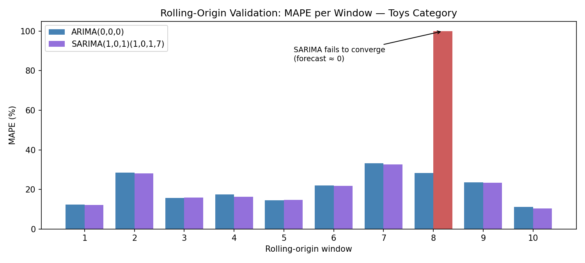
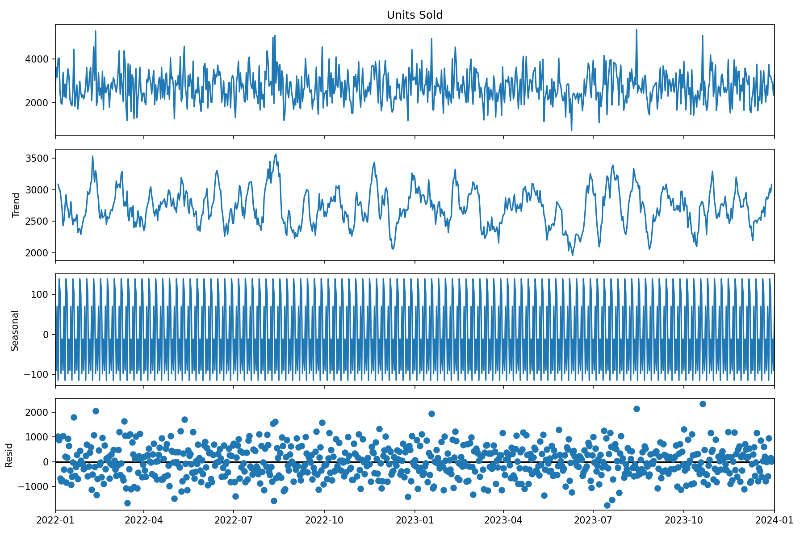
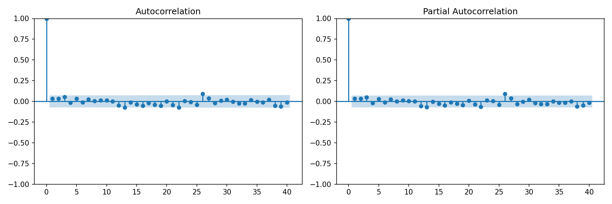

# Retail Demand Forecasting with ARIMA & SARIMA for Inventory Planning

**BSc Computer Science (Data Science) Final Year Project — University of Greenwich, 2026 · Graded First Class (71%)**

Forecasting daily retail demand with classical time-series models, then turning the forecast *uncertainty* into inventory decisions: safety stock and reorder point at a 95% service level.

The main lesson: **a single holdout test made SARIMA look like the better model. Rolling-origin validation showed it fails badly in some windows.**

---

## Key results

| Model | Holdout MAPE | Rolling-origin avg MAPE (10 windows) | Rolling-origin avg RMSE |
|---|---|---|---|
| ARIMA(0,0,0) — *selected* | 21.61% | **20.64%** | 671.02 |
| ARIMA(1,0,1) | 21.61% | – | – |
| SARIMA(1,0,1)(1,0,1,7) | **21.08%** | 27.55% | 845.87 |

| Inventory metric (95% service level, 7-day lead time) | Value |
|---|---|
| Average daily forecast demand | 2,725 units |
| Forecast standard deviation (σ) | 682 units |
| Safety stock = Z × σ × √L | **2,969 units** |
| Reorder point = (daily demand × L) + safety stock | **22,044 units** |


<!-- TODO: create this chart: MAPE per window for both models, Window 8 highlighted -->

---

## The problem

Retailers face two costly errors: **stockouts** (lost sales, unhappy customers) and **overstock** (tied-up capital, storage costs). Most forecasting tools give one number per day with no measure of how uncertain it is. Safety stock and reorder point calculations depend on that uncertainty, so this project uses the model's confidence intervals to set them.

## Data

- **Source:** [Retail Store Inventory Forecasting Dataset](https://www.kaggle.com/datasets/anirudhchauhan/retail-store-inventory-forecasting-dataset) (Chauhan, 2024, Kaggle). This is a **synthetic** dataset.
- 73,100 rows: 5 stores × 20 products × 731 days (Jan 2022 – Jan 2024)
- **Modelling series:** daily *Units Sold* for the **Toys** category, aggregated across all stores (731 observations)
- `Demand Forecast` column removed so it can't leak into the models

## Approach (CRISP-DM)

1. **EDA** (`eda.py`): ADF stationarity test (statistic −26.12, p ≈ 0, so d = 0), seasonal decomposition (weekly cycle, m = 7), ACF/PACF, monthly averages, holiday vs non-holiday comparison
2. **ARIMA** (`models.py`): grid search over 9 (p, q) combinations, selected by AIC/BIC
3. **SARIMA** (`models.py`): seasonal grid search with m = 7
4. **Holdout evaluation:** 80/20 time-ordered split (584 train / 147 test) using RMSE, MAE and MAPE
5. **Rolling-origin validation** (`rolling.py`): 10 windows. Each window adds 10 days to the training set, refits both models and forecasts the next 10 days
6. **Inventory translation:** forecast σ → safety stock and reorder point



## Findings

**1. The series has almost no structure to learn.** The ACF/PACF values fall inside the confidence band straight after lag 0. ARIMA(0,0,0) had the lowest AIC (9338.27), and ARIMA(1,0,1) gave the same MAPE. ARIMA(0,0,0) is a forecast of the series mean, so the most honest model for this data is "forecast the mean". The analysis supports that conclusion.



**2. Information criteria must be sanity-checked.** One SARIMA configuration returned an AIC of **12.00**. Every other model scored around 9,300–9,500. Its forecasts were close to zero, which shows a numerical fitting failure, not a better model. I rejected it and selected SARIMA(1,0,1)(1,0,1,7) using the ACF/PACF evidence.

**3. A single holdout gave the wrong answer.** On the 147-day holdout, SARIMA looked slightly better (21.08% vs 21.61% MAPE). Across 10 rolling windows, SARIMA failed to converge in **Window 8**. It forecast close to zero against actual demand of about 2,700 units, giving 100% MAPE. That one failure pushed its average to 27.55%, versus 20.64% for ARIMA. Without Window 8, SARIMA averaged 17.93% versus 20.71%. So SARIMA can be more accurate, but it isn't safe to deploy without convergence checks.

**4. The dataset has synthetic limits.** Average Toys demand per row was 135.07 units on holiday/promotion days and 136.77 on other days. Real retail data would normally show a clear promotion effect. This limits how much accuracy any univariate model can achieve on this data.

## Inventory recommendation

At a 95% service level with a 7-day lead time, the store should reorder when stock falls to **22,044 units**, including **2,969 units** of safety stock. The safety stock is large because demand is very volatile. The 95% interval spans roughly 1,400–4,100 units per day. Because the model measures this uncertainty explicitly, the store can still plan stock sensibly even though the point forecast is only modestly accurate.

## Limitations & future work

- **Synthetic data:** the next step is to run the same pipeline on real retail transactions
- **Aggregation:** combining stores and products hides detailed demand signals. Forecasting each store or product separately and summing ("bottom-up") would keep more signal
- **Univariate:** these models can't use price, promotion or weather. Extensions: ARIMAX/SARIMAX with external variables, or a machine learning model
- **Robustness:** add automatic convergence checks, with a fallback to the simpler model, so SARIMA can't fail silently

## How to run

```bash
git clone https://github.com/<username>/ARIMA-SARIMA-forecast.git
cd ARIMA-SARIMA-forecast
pip install -r requirements.txt
# Download retail_store_inventory.csv from the Kaggle link above into data/
python eda.py
python models.py
python rolling.py
```

## Repository structure

```
├── README.md
├── requirements.txt
├── data/                 # dataset (download from Kaggle)
├── figures/              # charts used in this README
├── eda.py                # exploratory analysis & stationarity tests
├── models.py             # ARIMA/SARIMA grid search, holdout evaluation, inventory metrics
├── rolling.py            # rolling-origin validation
└── report/
    ├── FYP_Report.pdf
    └── FYP_Poster.pdf
```

## Key references

- Fildes, R., Ma, S. and Kolassa, S. (2022). Retail forecasting: Research and practice. *International Journal of Forecasting*, 38(4), 1283–1318.
- Hyndman, R.J. and Athanasopoulos, G. (2018). *Forecasting: Principles and Practice*. OTexts.
- Makridakis, S., Spiliotis, E. and Assimakopoulos, V. (2018). Statistical and machine learning forecasting methods: Concerns and ways forward. *PLOS ONE*, 13(3).
- Silver, E.A., Pyke, D.F. and Thomas, D.J. (2017). *Inventory and Production Management in Supply Chains*.

Full reference list in [`report/FYP_Report.pdf`](report/FYP_Report.pdf).

---

**Author:** Mary Heng · [LinkedIn](#) · marylj026@gmail.com
